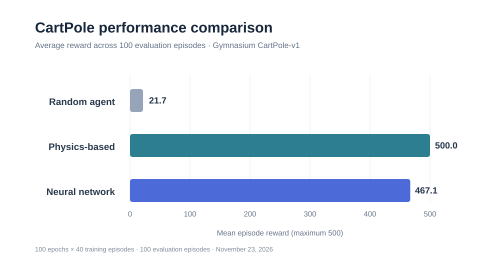

# CartPole Reinforcement Learning

I developed this project to explore different approaches to controlling the CartPole environment using Python. The objective is to keep a pole balanced on a moving cart by choosing whether to move left or right.

I wanted to see how a neural network trained through experience would compare with a simple physics-based controller.

## What I built

I implemented and compared three approaches:

1. **Random agent:** Selects actions randomly and provides a baseline for comparison.
2. **Physics-based agent:** Uses the pole's angle and angular velocity to determine which direction to move.
3. **Neural network agent:** Learns from successful episodes and uses epsilon-greedy exploration during training.

For the neural network, I used scikit-learn's `MLPClassifier` with two hidden layers of 64 neurons. The model learns from the highest-performing episodes using an elite-episode training approach (the cross-entropy method), rather than Q-learning or DQN.

I also wrote scripts to train the model, evaluate all three agents using the same environment seeds, and visualize their performance.

## Results

I trained the neural network for **100 epochs**, with **40 episodes per epoch**, and evaluated each agent over **100 episodes** in Gymnasium's `CartPole-v1`. The maximum reward per episode is 500.



| Agent | Average reward | Episodes scoring at least 475 |
| --- | ---: | ---: |
| Random | 21.7 / 500 | 0 / 100 |
| Physics-based | 500.0 / 500 | 100 / 100 |
| Neural network | 467.1 / 500 | 76 / 100 |

The neural network performed substantially better than the random baseline, achieving an average reward of **467.1**. However, the physics-based controller achieved the maximum reward in every evaluation episode.

I found this comparison especially interesting because it shows that a well-designed rule can outperform a trained model in a relatively simple environment. While the neural network learned an effective strategy, its performance was less consistent across episodes.

The results come from a successful [Gymnasium experiment on GitHub Actions](https://github.com/koufosa/cartpole-rl-benchmark/actions/runs/45241257740). I included a [more detailed breakdown](reports/official-gymnasium-benchmark.md) and the [saved results and plots](https://github.com/koufosa/cartpole-rl-benchmark/actions/runs/45241257740/artifacts/14852625271).

## Running the project

Python 3.10 or newer is required.

```bash
git clone https://github.com/koufosa/cartpole-rl-benchmark.git
cd cartpole-rl-benchmark

python3 -m venv .venv
source .venv/bin/activate
python -m pip install -e '.[dev]'
```

Train the neural network:

```bash
cartpole-benchmark train --epochs 100 --episodes-per-epoch 40
```

Evaluate the three agents:

```bash
cartpole-benchmark evaluate --episodes 100
```

Watch the trained agent (requires a graphical display):

```bash
cartpole-benchmark demo --agent neural
```

Training and evaluation save CSV files and plots to the `outputs/` folder. To run the tests, use `python -m pytest -q`.

## Tools

Python, Gymnasium, NumPy, scikit-learn, Matplotlib, pytest, and GitHub Actions.

## Next steps

I plan to compare different exploration rates, train the model with multiple random seeds, and test whether a different learning approach can produce more consistent results.
