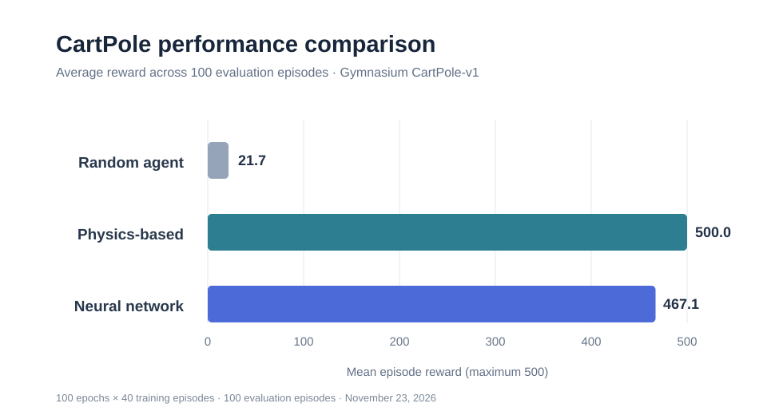

# CartPole Results

I compared three approaches to the CartPole problem to evaluate how effectively each could keep the pole balanced.

I used Gymnasium's `CartPole-v1` environment, where an episode has a maximum reward of 500. The neural network was trained for 100 epochs, with 40 episodes per epoch, and each controller was evaluated over 100 episodes.

## Performance comparison

| Agent | Average reward | Episodes scoring at least 475 |
| --- | ---: | ---: |
| Random | 21.7 / 500 | 0 / 100 |
| Physics-based | 500.0 / 500 | 100 / 100 |
| Neural network | 467.1 / 500 | 76 / 100 |

The neural network significantly outperformed random actions and maintained balance for most of each episode on average. However, its performance varied across the 100 evaluation episodes.

The physics-based agent performed best, reaching the maximum reward in every episode. I found this particularly interesting because it demonstrated that a simple, well-designed control strategy can sometimes be more effective than a learned model.

## Neural network training

I used a neural network with two hidden layers of 64 neurons. It was trained using the better-performing episodes while gradually reducing random exploration.

The final training batch had an average reward of **108.3**, compared with **467.1** during evaluation. Training included exploratory actions, while evaluation used the model's preferred action at each step, which helps explain the difference.

## Experiment files

I ran the experiment through [GitHub Actions](https://github.com/koufosa/cartpole-rl-benchmark/actions/runs/45241257740). The [results files](https://github.com/koufosa/cartpole-rl-benchmark/actions/runs/45241257740/artifacts/14852625271) include the training and evaluation plots, CSV outputs, and trained model.

## Next steps

I would like to test multiple training seeds, compare different exploration schedules, and experiment with another reinforcement learning approach to see whether it produces more consistent results.
