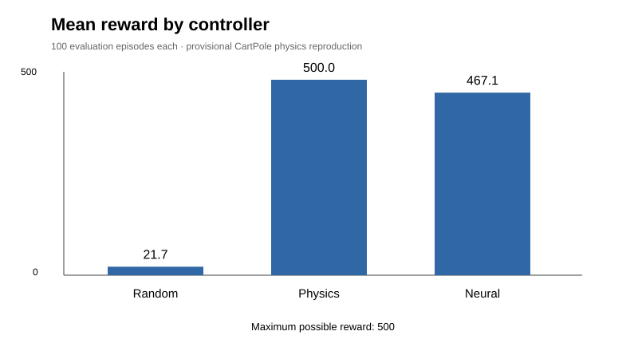
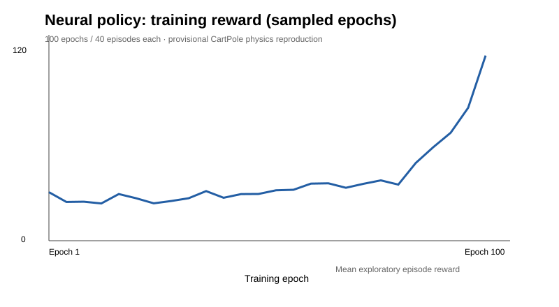

# Provisional CartPole benchmark — 100 epochs

> **Not an official Gymnasium result.** The package was unavailable in the local execution environment. To test the training pipeline, the project was run against a local reproduction of the published CartPole physics equations. These figures must be confirmed on the official Gymnasium environment using [GitHub Actions](../../actions/workflows/benchmark.yml) before being treated as definitive.

## Setup

- Neural policy: two hidden layers of 64 nodes, scikit-learn MLPClassifier with `partial_fit`
- Training approach: elite-episode cross-entropy method, not DQN/Q-learning
- Training: 100 epochs × 40 episodes; elite percentile 70
- Exploration: ε decays linearly from 0.9 to 0.05
- Training environment seeds: start at 42, unique per episode
- Evaluation: 100 episodes, reset seeds 10000–10099, greedy neural policy
- Max possible episode reward: 500

## Provisional charts

## Measured results (local physics reproduction only)

| Agent | Mean reward | Standard deviation | Median reward | Success ≥475/500 |
| --- | ---: | ---: | ---: | ---: |
| Random | 21.68 | 10.97 | 18.5 | 0% |
| Physics heuristic | 500.00 | 0.00 | 500.0 | 100% |
| Neural policy | 467.10 | 63.10 | See evaluation CSV | 76% |

A separate shorter trial of 30 epochs × 25 episodes yielded a mean neural test reward of 73.6; the longer run materially improved this particular seed's performance. This does not establish reliable performance across multiple **training** seeds.

**Interpretation:** The trained neural agent outperformed random actions in this local benchmark but did not beat the simple physics heuristic, which perfectly balanced the pole on all 100 tested initial conditions. The result illustrates both the value of learning and the importance of comparing with inexpensive, hand-crafted baselines.

## Reproduce with Gymnasium

1. Open the [CartPole experiment workflow](../../actions/workflows/benchmark.yml).
2. Choose **Run workflow** or view the latest run started by a push.
3. Retrieve the `cartpole-gymnasium-results` artifact from a completed run.
4. Use the official run's CSVs and plots to replace this provisional summary.

## Limitations

- Local physics implementation is intended to reproduce the core standard CartPole dynamics but has not been independently validated against the official installed Gymnasium package.
- Statistics above summarize 100 **evaluation** episodes from **one trained model**, not repeated independent training runs.
- Matched environment reset seeds do not imply identical action randomness.
- The heuristic uses privileged knowledge of a simple control law; more complex environments would require different baselines.

The project README deliberately does **not** claim official Gymnasium results until those are independently obtained.
